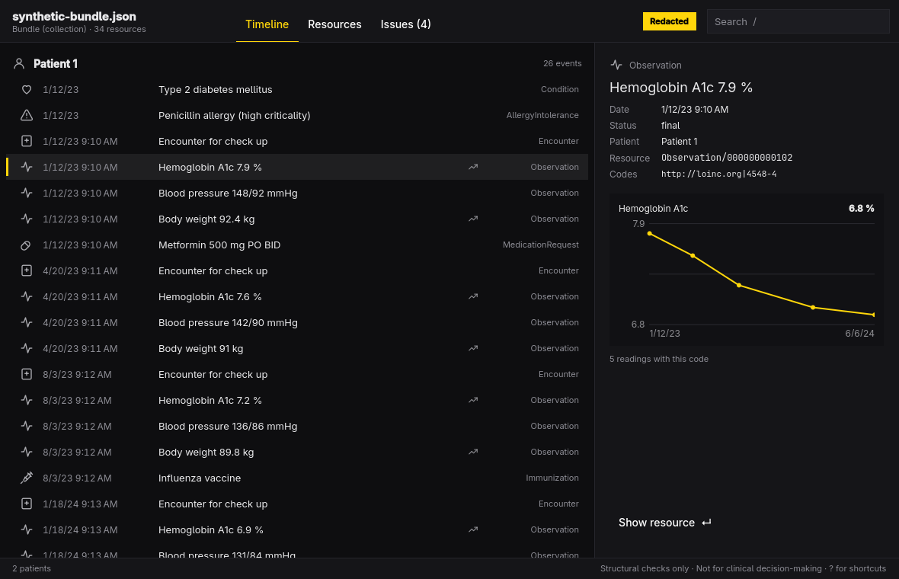

# FHIR



Open a FHIR R4 JSON resource, Bundle, or NDJSON bulk export, check its
structure, and read it as a patient timeline. Built for
[Omarchy](https://omarchy.org): one window, driven from the keyboard,
following the desktop theme and language.

> **Not a certified validator. Not for clinical decision-making.**
> `fhir` runs structural checks only. It does not check profiles (US Core,
> IPS, or any other), terminology bindings beyond a few required code sets,
> or FHIRPath invariants. A file with no issues is not thereby conformant,
> and nothing it shows should inform the care of a patient.

## What it does

- **Opens** `.json` resources and Bundles and `.ndjson` bulk-export files,
  through the desktop's file picker or by dropping a file on the window. The
  source file is only ever read. Large files open in the background; a 53 MB
  Synthea bundle (19,000 resources) checks in about two seconds.
- **Checks structure**: valid JSON; `resourceType` present and a known R4
  type; required elements and required code sets (`status`, `intent`,
  `gender`, …) for Patient, Encounter, Observation, Condition,
  MedicationRequest, Procedure, AllergyIntolerance, Immunization, and
  DiagnosticReport; primitive formats (date, dateTime, instant, id, code);
  FHIR JSON rules (no empty strings, arrays, objects, or nulls); and Bundle
  references (`fullUrl` and `Reference.reference`) that resolve within the
  file. Every issue has a severity, a path, and a message.
- **Timeline**: one row per dated event (encounters, observations,
  conditions, medication requests, procedures, immunizations, reports, and
  allergies) in date order, grouped by patient, each with a one-line summary
  such as `Hemoglobin A1c 7.2 %` or `Metformin 500 mg PO BID`. Times show as
  recorded, in their own offset.
- **Trends**: numeric observations that share a code (LOINC first) and a unit
  are drawn as a small chart. One painter draws it on screen and in exports.
- **Resources**: resource types and counts, the selected resource as
  pretty-printed JSON, and its references in and out, which you can follow.
- **Issues**: the validation report, sorted by severity or file order.
  Opening an issue jumps to its resource with the path highlighted.
- **Filter and search**: filter the timeline by resource type and date range,
  and search display text and codes across all three views.
- **Redaction**: one key masks names, identifiers, addresses, telecom, birth
  and death dates, photos, narrative, free text (notes, comments,
  conclusions, string values), and the ids of patients and practitioners, on
  screen and in every export, for screenshots and demos. Patients become
  "Patient 1", "Patient 2" in the same order everywhere.
- **Export** the validation report as JSON or CSV, and the timeline as CSV,
  a printable PDF, or SVG. Exports are written beside the target and renamed
  into place, so a failed export never leaves half a file.

## Keys

| Key | Does |
| --- | --- |
| `Tab` / `Shift+Tab` | Next / previous view: Timeline, Resources, Issues |
| `1` `2` `3` | Go to a view |
| `J` `K`, `↓` `↑` | Move (`PgUp`, `PgDn`, `Home`, `End` too) |
| `Enter` | Open the resource, follow a reference, fold a type, or jump to an issue |
| `Backspace` | Go back |
| `N` / `Shift+N` | Next / previous reference (Resources) |
| `Space` | Show or hide the detail pane |
| `/` | Search |
| `F` | Filter the timeline by type and date |
| `Esc` | Clear the search, then the filter |
| `S` | Sort issues by severity or file order |
| `P` | Toggle redaction |
| `Ctrl+E` | Export |
| `Ctrl+O` | Open a file |
| `?` | Show the shortcuts |
| `Q` | Quit |

## Command line

Every command runs without a display, prints `--json` for scripts and
agents, and exits 0 or 1 with errors on stderr.

```sh
fhir check bundle.json --json        # exits 1 on errors; --strict fails on warnings too
fhir summary bundle.json --json      # resource counts, patients, date range
fhir timeline bundle.json --csv      # or --json; --patient, --type, --from, --to, --search
fhir open bundle.json                # the window
fhir skill install                   # an agent skill in ~/.agents/skills/fhir
```

Add `--redact` to any command to mask identifying details in its output.

Transaction bundles and bulk exports can hold thousands of conditional
references (`Location?identifier=…`) and references to other files; each kind
is counted in one line rather than listed one by one.

`examples/` has a synthetic Bundle (two made-up patients, four deliberate
errors) and an NDJSON export to try it on.

## Install

On Omarchy:

```sh
bin/install
```

This builds the package with `makepkg` and installs the binary, the launcher
entry, and the icon, so FHIR shows up in the app launcher (`Super + Space`).

## Development

C++17 and Qt Quick, built with `qmake6` and `make`:

```sh
bin/build      # build/fhir
bin/test       # the Qt Test suite, offscreen, on synthetic data only
```

`src/` holds the loader (`fhirfile`), the checks (`validator`), the timeline,
redaction, exports (`report`), the trend painter, the command line, and the
QML. Translations live in `src/i18n/` as JSON catalogs keyed by the English
text; the app follows the language picked under Omarchy's Setup > Language.

Tests and examples use synthetic data only. Please don't add real patient
data to issues, tests, or fixtures.

## License

MIT. Theme watching, the translator, and the portal file picker follow
[Omacut](https://github.com/omacom-io/omacut) and Monologue by David
Heinemeier Hansson, also MIT.
